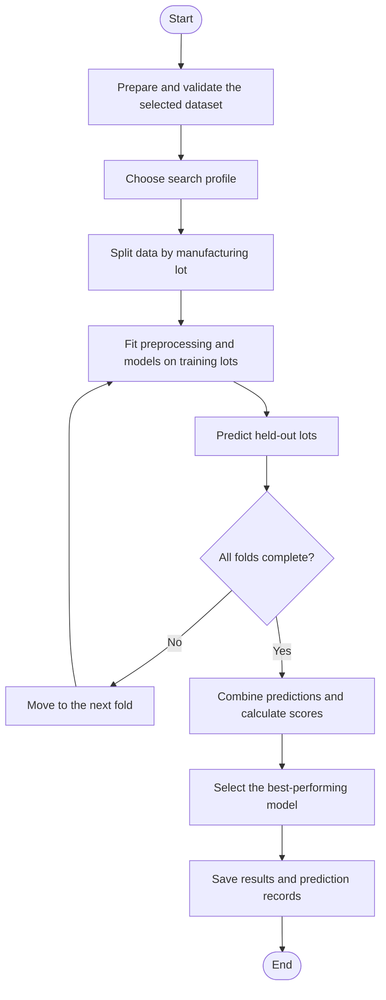

# 4.2.4.3 Agent-Coordinated Model Training and Prediction

The Bosch and equipment-data routes use the same coordinated workflow. The system first prepares the data, then chooses the training settings, evaluates candidate models, selects the best-performing model and saves the results. Each dataset uses its own preparation functions and modelling settings within this shared workflow.

Two software agents divide the work. The data agent checks the source files, matches input records with their measured results and prepares the features. The model agent receives this prepared dataset and handles model evaluation and result saving. The agents are Python classes with defined tasks. The optional Groq language model is used only to help choose training settings.

`PredictionCrew` coordinates both stages. `EquipmentPredictionCrew` supplies the equipment agents and settings, while `BoschPredictionCrew` supplies the Bosch agents and settings. Both use the same execution sequence. The data are prepared once and passed directly to the model agent. If preparation fails, training does not start. A validation-only option runs preparation without fitting models.

*Figure 4.6: Shared model training and evaluation workflow for Bosch and equipment data. The search profile is selected by the optional Groq planner or set to the balanced fallback.*

**Choosing the training settings.** Both model agents use `PredictionModelAgent` for the planning stage. The planner receives a summary of the current prepared dataset and chooses a conservative, balanced or extensive search profile. These profiles define the model settings considered during evaluation. The planner is limited to eight decision attempts. If it is disabled or cannot return an accepted choice, the system uses the predefined balanced profile. Groq does not calculate evaluation scores or select the winning model.

**Training and evaluation.** Both routes keep complete manufacturing lots together during validation. In each fold, preprocessing and model fitting use only the training lots. The models then predict the held-out lots, which were excluded from fitting. Repeating this process produces an out-of-fold prediction for each evaluated record. The combined predictions are used to calculate MAE, RMSE and R². The regression candidate with the highest out-of-fold R² is selected as the best-performing model.

Bosch uses `GroupKFold` with up to five folds, depending on the number of available lots. Equipment data uses `StratifiedGroupKFold` with the configured number of folds. This also attempts to balance the good and bad response groups across folds. Equipment regression additionally uses inner lot-grouped validation to choose candidate hyperparameters. These dataset-specific settings operate within the same coordinated workflow.

**Bosch prediction tasks.** Bosch evaluates wafer-average etch prediction and spatial etch prediction. The wafer-average task uses process features. The spatial task compares process features only, coordinates only, and both together. This comparison helps show how much predictive performance comes from measurement location. All measurement points belonging to a wafer remain with that wafer's manufacturing lot during validation.

The Bosch model agent also evaluates research screening by applying a threshold to predicted wafer-average silicon etch. Regression and screening receive the same prepared dataset and selected search profile. The screening threshold is a configurable research rule because the public dataset does not provide an official production pass/fail limit.

**Custom equipment regression model.** The project also retains `QualityHurdleForestBlend` for experiments and previously saved model results. It combines a group-based response estimate with a Random Forest estimate. The first component estimates the probability that a wafer belongs to the bad-response group. For this dataset, a response above 0.75 defines that group. The component uses the good-group and bad-group average responses from the training data to turn the estimated probability into a continuous prediction.

The probability is multiplied by the configured scale of 0.75 and restricted to the range from zero to one. A lower value produces a prediction closer to the good-group average; a higher value moves it towards the bad-group average. Both response groups must be present in the training data for this component to fit.

The Random Forest component predicts the response directly from selected features. Its implemented defaults select 120 features and use 180 trees, a maximum depth of eight and at least three samples per leaf. The final prediction combines 70% of the group-based estimate with 30% of the Random Forest estimate. Both components are fitted within the active training fold. These are configured settings whose effectiveness must be assessed using the measured results.

The custom model also provides a feature-relevance table by combining the relevance scores of its two components. This table is not a SHAP explanation. The continuous regression model is evaluated separately from the equipment classifier that predicts the bad-wafer category.

The active equipment training function compares nine standard regression algorithms: Ridge, Lasso, ElasticNet, KNN, Random Forest, Extra Trees, histogram gradient boosting, XGBoost and LightGBM. The custom hurdle-forest model is not currently in that candidate list. Previously saved hurdle-model scores therefore describe an earlier model configuration and should be identified as such when reporting results.

**Saved evidence.** Both routes save evaluation scores and individual prediction records. These records connect predicted and measured results with lot or wafer identifiers, allowing errors to be examined in detail. The equipment route also saves a fitted model bundle, fold-level metrics, feature relevance, sensor-quality information and provenance. Bosch saves regression and screening ledgers, summary tables and an Excel regression report. The dashboard can display these saved outputs without repeating training. Performance results and their limitations are discussed in Chapter 5.

---

Implementation note: this section describes the shared coordinator. Previously generated benchmark files are not automatically retrained by this refactor. The equipment dashboard allows the validation fold count to be configured; it should not be described as always using five folds.
